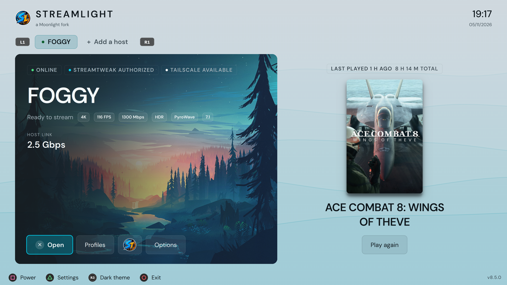
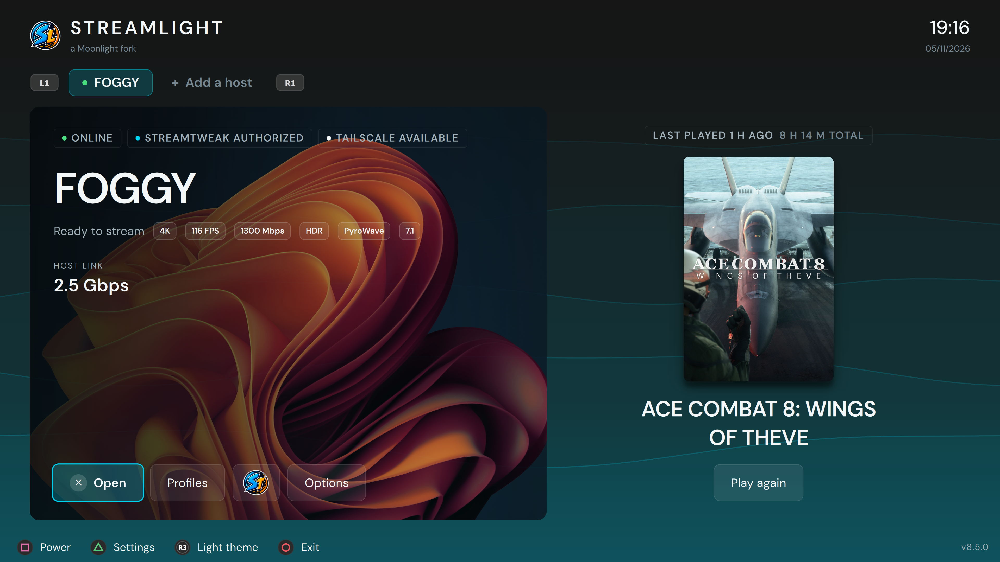

##  StreamLight

[](https://github.com/FoggyBytes/StreamLight) [](https://www.qt.io/) [](https://github.com/FoggyBytes/StreamLight/releases) [](https://github.com/moonlight-stream/moonlight-qt) [](https://claude.ai/code) [](https://ko-fi.com/foggybytes)

<div align="center">
  
</div>

**StreamLight** is the client half of the FoggyBytes streaming duo: a fork of [Moonlight](https://github.com/moonlight-stream/moonlight-qt) with a gamepad-first interface and native integration with its host-side companion, [**StreamTweak**](https://github.com/FoggyBytes/StreamTweak).

The streaming engine is upstream Moonlight's — FFmpeg, D3D11VA, DXVA2, libplacebo, `moonlight-common-c` — with Nonary's VRR pacing added in 6.0.0 and his PyroWave codec in 6.4.0. What is new sits around it: the interface, and everything the two apps can do together over a local TCP bridge — host link matching, host metrics in the overlay, the store each game comes from, session quality reports, remote power-off and Windows Update, Tailscale, and signing a woken host in with its PIN from the sofa.

<div align="center">
  
</div>

## ✅ Compatibility

Windows 10 and 11. Works as an ordinary Moonlight-compatible client against any **Sunshine / Apollo / Vibeshine / Vibepollo** host, and unlocks its paired feature set when [**StreamTweak**](https://github.com/FoggyBytes/StreamTweak) is running on the host.

> 🔐 **The bridge is authenticated.** Every command StreamLight sends is signed with its existing Moonlight identity certificate; the host approves each client once, via a 4-digit PIN shown on both screens. **Streaming never depends on it** — without approval you stream normally and simply lose the paired features. Each host card shows its state as a badge (AUTHORIZED / PENDING / DENIED).

> ⚠️ **Windows SmartScreen and Smart App Control.** StreamLight is not code-signed yet.
> - **SmartScreen** may warn you when you run the installer: choose *More info → Run anyway*.
> - **Smart App Control**, on the Windows 11 PCs where it is turned on, may block StreamLight outright, and it offers no per-app exception. The only way to run it there is to turn Smart App Control off (*Windows Security → App & browser control → Smart App Control settings*).
>
> Keeping Smart App Control on is a perfectly reasonable choice. Code signing is being looked into, and this note will be updated if that changes. The full source is in this repository.

> 🛡️ **Security and privacy.** No analytics, no telemetry, nothing sent to FoggyBytes. How StreamLight is protected and how to report a vulnerability is in [SECURITY.md](SECURITY.md); every connection it makes is listed in [PRIVACY.md](PRIVACY.md).

> ⚠️ **Not affiliated with or endorsed by the Moonlight project.** StreamLight is an independent fork. For upstream Moonlight support, use the [official client](https://github.com/moonlight-stream/moonlight-qt).

## 🔥 Features

Everything below is in the current release, whichever version first introduced it.

**🕹️ Gamepad-first, keyboard-equal**
- Every action is reachable from the pad: D-pad across host tabs, library, settings tabs and dialogs, with a clickable prompt bar along the bottom
- **Prompts follow the device in your hands** — touch the keyboard and each glyph becomes the key to press; pick the pad back up and they return to that controller's own icons (Xbox / PlayStation / Nintendo / Steam, auto-detected or forced; Steam *(6.5.1+)*). *Settings → Interface* can pin them to the controller or to the keyboard *(6.3.0+)*, for Steam Input and the Steam Deck, where one pad also sends clicks and keys — and on the controller a trackpad mapped to the mouse points without taking the focus away from the pad *(6.4.1+)*
- **Rebindable shortcuts** — every in-stream keyboard hotkey and all four controller combos, in *Settings → Shortcuts*. Defaults are **LB + RB + A** quit (closes the game on the host), **+ Y** pause (leaves it running, to resume), **+ X** performance overlay, **+ B** stream settings, chosen to stay clear of Steam's overlay
- **On-screen keyboard** *(8.0.0+)* — every field that needs typing (profile and host names, a host's address, the accent colour, a custom frame rate or resolution) opens a keyboard at the bottom of the screen when you reach it with a controller; the right stick moves it out of the way
- **Navigation sounds** *(7.0.0+)* — soft sounds for move, confirm and back from the controller and the keyboard, and *(7.0.3+)* from mouse clicks, never a hover; volume and switch in *Settings → Interface*
- **Controller charge** *(8.7.0+)* — the controllers connected without a cable appear in the top-right corner, beside the time, with their maker's logo over a four-step gauge — amber when one is about to run out, green with a bolt while it charges. Xbox (adapter or Bluetooth), DualSense and DualShock 4, Switch Pro and Joy-Con, Valve's newer controllers; the charge of the original Steam Controller and of the Switch 2 controllers cannot be read yet, as the SDL library does not provide it
- **DualSense haptics** *(7.0.0+)* — the fine vibration games play through the DualSense's actuators reaches the controller in your hands, over USB or Bluetooth, from a Vibeshine or Vibepollo 2.0.1+ host with its *DualSense USB audio and haptics* component

**🏠 Home and the host page**
- **Home** is your hosts as tabs under the wordmark. The selected one's card takes the left of the screen — name, state, addresses, stream settings and actions at once — and its game stands beside it. **LB / RB** move between hosts, **LT / RT** between that host's profiles — as on the host page *(7.0.0+)*
- **Moving background** *(6.0.0+)* — waves in your accent colour rise over the lower three quarters of Home, Settings and the PIN pad, twice as fast while a host is streaming. Still with *Reduce animations*, paused behind dialogs
- **Opening animation** *(6.0.0+)* — the waves rise, the icon fades in and a band of light writes STREAMLIGHT before Home appears; any button skips it, and *Settings → Interface* turns it off
- **Start at sign-in** *(8.2.0+)* — StreamLight opens when you sign in to Windows and asks where to go: **A** for StreamLight, **B** for the Windows desktop, StreamLight by itself after 10 seconds. No host is contacted before you choose. Switched on in *Settings → Interface*
- **The TV follows this PC** *(8.4.0+)* — with an LG webOS TV, *Settings → TV* pairs it once and then the TV comes on and switches to this PC's input when the PC starts, and goes off when it shuts down; a restart or sleep leaves it on. A small StreamLight service does it from boot, so the TV is on at the Windows sign-in screen too. A TV showing another input or app is left alone, and a soundbar on HDMI goes off with it. LG webOS TVs only
- **The host page** puts the library down the left at full height and the game in the spotlight beside it — cover, name, store, and the right verb (*Resume* if it is already running, *Play* if not)
- **Grid of covers** *(8.1.0+)* — the left stick click or **V** turns the host page's list into a wall of covers, keeping the selected game; in the grid the bottom bar carries Play, Per-game settings and Stop, and the covers mark the game streaming now, the last one played and the pinned ones. *Settings → Interface* picks the layout, the cover size and whether titles show
- **Library search** *(8.4.0+)* — a magnifier before *ALL* on the host page (**LB** from ALL, **/** or **Ctrl+F**, a click) searches the library in both layouts as you type, ignoring case, accents and punctuation; with a controller **A** opens the on-screen keyboard, and **B** goes back to the tab you came from with the game found selected
- **All, Games and Apps** *(5.9.0+, All 6.1.0+)* — **LB / RB** switch the host page between everything you can launch, the games, and everything else: Desktop, Virtual Display, Steam Big Picture and the host's controls, which open with *Open* and never count hours. The page reopens on the tab you last chose on that host *(6.3.0+)*, All the first time; **LT / RT** move the host's profile
- **Move between Games and Apps** *(6.1.0+)* — the **right stick click** or **M** moves the selected entry to the other tab, remembered per host. The host's own controls stay on Apps
- **Remote Input and Remote Monitor** *(5.9.0+)* — the host controls of Vibeshine and Vibepollo 2.0 open beside a running game, and their results and confirmation requests appear as messages and Yes/No questions rather than errors
- **Last played** *(5.7.0+)* — the game you last streamed on that host fills the right of its card, with how long ago you left it and the hours you have played it in total. **Play again** starts it without opening the library, and the same game sits first on the host page under *Last played*
- **Play time** *(5.7.0+)* — how long you have streamed each game, beside the store on every row. Filed under the game's name, so it survives a reinstall, and resettable from the per-game panel
- **Pinned games** *(6.0.0+)* — **Start** on the pad (Menu / Options / +) or **P** pins the selected game: pinned games sit under their own heading right after *Last played*, alphabetically, marked with a pin on the row. Kept per host and by name, so a pin survives a reinstall
- **Resume from Home** *(6.0.0+)* — while a host is streaming, its card shows the game in progress, marked *Streaming now*, with **Resume** in place of *Play again*
- **Wake through a second network card** *(8.1.0+)* — the *Wake-on-LAN* tile in a host's Options takes the MAC address of another card of the same PC; **Wake** sends the magic packet to both
- **Per-host backgrounds** — *(7.0.0+: a small popup that previews on the card)* a picture of your own, and *(6.0.0+)* how much of the moving background shows through the card, from 70% to 100%. Without a picture the card wears your accent colour, in a gradient
- **Your accent colour** *(7.0.0+: a palette of 24, previewed live)* — or any hex code. Status colours never follow it: online stays green, a pending link change amber, *Shutdown* red
- **Light or dark** *(7.0.0+)* — *Dark*, *Light*, *System* or *Auto* (sunrise and sunset, or two set hours), switched from Home with the right stick click, and an interface scale of 90%, 100% or 110%
- **Time, date and battery** in the top right of every screen, in the clock and date format you read

**🎬 In-stream**
- **Performance overlay, built line by line** — thirteen lines to choose from, switched on and off *on the overlay itself* in Settings, plus corner, size and transparency. Minimal / Default / Full remain as starting points. *(8.3.0+)* A card in sections or a **bar** at the top centre with its own presets, in the app's fonts and accent, sized to the screen; a figure turns red when it signals a problem
- **Stream Settings panel** — change resolution, frame rate, bitrate, HDR and frame pacing **while streaming**, applied with a brief reconnect and host-agnostic. *(8.3.0+)* A row of tiles at the bottom centre, clear of the performance overlay. *(8.4.0+)* A sixth tile turns controller mouse control (hold Start) on or off, at once and without the reconnect
- **Custom resolutions and frame rates** — any width and height, and any rate, not just the presets, from Settings or the in-stream panel
- **Your display's own values are offered too** *(5.5.0+)* — the resolution and refresh rate this machine reports appear in the pickers, so a 165 Hz or 16:10 screen needs nothing typed in. Marked with a dot in *Settings* and with the words *this display* in the in-stream panel, which offers the same list
- **Frame pacing** — Off or On, evening frames out with the same software pacer Moonlight uses
- **Fractional V-Sync** *(5.6.0+)* — shows each frame for a whole number of refreshes instead of once per refresh, so 60 FPS on a 120 Hz screen becomes one frame every two. Needs V-Sync and frame pacing, and a screen running at an exact multiple of the frame rate: at 60 FPS that is 120 / 180 / 240 Hz, and a 144 Hz screen wants 72 FPS. Off by default
- **VRR** *(6.0.0+, experimental)* — on a variable-refresh display each frame is shown as soon as it is ready, with three timing profiles (*Low latency*, *Balanced*, *Smooth*) and *Reduce judder*. Built on Nonary's VRR work for Moonlight; needs V-Sync, runs borderless, and switches Fractional V-Sync off while it is on
- **PyroWave** *(6.4.0+)* — a fifth video codec for wired networks: every frame is coded on its own, so decoding takes well under a millisecond and a lost packet blurs part of one picture instead of breaking the next ones. Needs hundreds of Mbps and a Vibeshine or Vibepollo 2.0 host; other hosts stream H.264
- **PyroWave Test** *(7.0.0+)* — from the host's Options: measures the wired network to the host and this device's decoder, offers a bitrate for the target you pick, and lets later PyroWave streams send their frames at the pace it found. Needs Vibeshine or Vibepollo 2.0.1+

**⚙️ Settings and profiles**
- Nine tabs, pill-style selectors instead of dropdowns, inline subtitles instead of tooltips, and a bitrate slider with hold-to-accelerate and a **Default** prompt
- **Per-host profiles** — as many named profiles per host as you like *(three before 8.0.0)*, each overriding resolution, frame rate, bitrate, HDR, YUV 4:4:4, codec, display mode, V-Sync, frame pacing, fractional V-Sync, VRR, audio, link matching and launch wait. Switchable from Home or the host page, in an order you set *(8.8.0+)*; on Home, **Start** (**W**) also opens a list of them *(8.7.1+)*
- **Per-game overrides** on top of the active profile, for the settings that vary by title
- **Profiles in one list** *(8.8.0+)* — the host profile and per-game dialogs fill the window: on the left the profiles (or the game), on the right every setting in sections, each value a single badge that **A** opens into its choices
- **Inherited values look inherited** *(6.0.0+)* — the accent marks only what a profile or a game changes, every row says where its value comes from, **Y** gives a row back, and **X** names a profile from eight ready-made names, or your own — with a controller, through the on-screen keyboard *(8.0.0+)*
- A setting that cannot act says so wherever you meet it — greyed, with the reason on the line beneath, in Settings, in the profile and in the per-game dialog alike
- Every change is written to disk the moment you make it
- **Logs and cache** *(6.5.0+)* — *Settings → About* shows where logs, crash dumps and covers are kept and how much space they take, opens each folder and clears them after a confirmation. Logs and crash dumps can move to another folder, and the running log follows at once
- **Update from the app** *(5.8.0+)* — *Settings → About* downloads a newer release when there is one and checks it against GitHub's checksum. *(8.6.0+)* *Install now* installs it with the controller alone: no setup wizard and no Windows permission prompt, a full-screen page follows the update, and StreamLight reopens by itself. A newer version is also announced at startup

**🎯 Xbox app and Steam integration**
- Branded tile artwork in the Windows 11 Xbox app's "My apps" section, seeded during setup and re-applied automatically whenever the Xbox app overwrites it
- **Steam artwork** *(7.0.0+)* — added to Steam as a non-Steam game, StreamLight gets its own cover, header, background and logo in the library and in Big Picture from *Settings → Interface → Steam artwork*, on every Steam account on the PC; pictures you chose yourself are left alone. The images are also in the *Steam artwork* folder of the install, for assigning by hand

## 🔗 Paired Features (with StreamTweak)

These cross the bridge and need both apps. The version shown is the **minimum StreamTweak** on the host.

- **StreamTweak section** *(10.0.0+)* — StreamTweak's logo on the host card opens the host's own pages, on the pad: a **Dashboard** of the host at rest (GPU, temperature, VRAM, CPU and RAM as they are now, who is streaming from it, link speed with Match and Restore, spatial audio, Windows Update), its **Sessions** — the history with each verdict, its four checks and a timeline read with the right stick (from 10.0.4 with every series of Host compute and Host power), two sessions side by side, and *(8.2.0+, StreamTweak 10.0.6)* a session deleted with the right stick click —, its **Library** — the games the streaming server lists, and *Sync and restart* to add new ones without going to the host —, its **Apps** managed by StreamTweak and **NVIDIA Sentinel**. Changing anything needs **Host management** for this device, granted on the host; without it the pages are read-only, and only switches ever travel — no path, no command

All of them are switched on **per host**, in the **Setup** tab of the host's StreamTweak section *(Settings → StreamTweak before 8.0.0)* — a host added from StreamLight 5.2.0 on starts off, and hosts you were already using StreamTweak with are switched on for you on first run. Streaming itself is never affected either way.

- **Host link matching** *(8.1.0+)* — before each launch StreamLight measures the wired link that actually reaches that host, asks the host to come down to it, and starts the stream only once the host confirms. A host running faster than the client sends each frame as a burst the slower link cannot drain, and the packets that die first are the few carrying audio: the symptom is sound cutting out while the picture stays perfect. The client decides the speed because only the client knows its own connection; the host keeps the permission and the restore
- **Seamless launch** *(8.1.0+, opt-in)* — with **Wait for the game to appear** on, the stream window stays hidden until the host reports the game is really on screen, so you watch the game's cover art instead of the host's desktop rearranging itself. **B** or **Esc** reveals the host at any moment. A resume never waits: the game is already there
- **A game left open after Quit** *(9.2.3+)* — a few seconds after a **Quit session**, StreamLight asks StreamTweak whether the game is still running and says so when the streaming server could not close it, as with Xbox app games; *(8.2.0+)* a game that is only slow to close is asked about again for half a minute first
- **Remote PIN unlock** *(8.1.0+)* — after a **Wake**, or *(7.0.0+)* from the **Unlock** button of any host sitting at its lock screen and before any launch on it, a controller-navigable number pad takes its Windows PIN. The session carrying the PIN is never shown and never recorded on the host; wrong attempts stop at three, since Windows suspends the PIN after a few failures
- **Host metrics in the overlay** *(4.4.0+)* — GPU %, encoder %, GPU temperature, VRAM, CPU and network TX, hidden entirely when StreamTweak is unreachable
- **Store badges** *(5.0.0+)* — which store the selected game comes from, its mark beside its name on the host page: Steam, Epic, GOG, Ubisoft, Xbox, Battle.net and EA App
- **Session quality reporting** *(5.2.0+)* — FPS, drops, RTT, jitter, decode latency and bitrate sent every second; StreamTweak turns them into a grade and charts
- **Delivered vs target bitrate** *(8.0.0+)* — StreamLight reports the rate it was told to aim for, so the host can show what it actually delivered against it. Neither side can work that out alone
- **Remote host power-off** *(7.2.0+)* — a **Power…** chooser for the host, this PC, or both, on an authorized host only
- **Sleep and restart** *(8.6.0+)* — one row per machine in the Power chooser, each offering only what that machine supports
- **Remote Windows Update** *(7.3.0+)* — scan, classify and install updates on the host, rebooting only if required, with a backgroundable progress view. Updates can also be installed before a shutdown
- **Remote session pause** *(6.0.0+)* — the Pause button on StreamTweak's dashboard ends the stream client-side
- **Tailscale in one tile** *(6.3.0+)* — a host reachable both on the LAN and over Tailscale stays a single tile that tracks both addresses and uses whichever is available, with an option to force the `100.x` endpoint. Pairs with the **Auto-start Tailscale** toggle, so opening StreamLight is enough to stream from anywhere
- **Shared clipboard** *(8.7.0+)* — text copied on the host pastes on this device and the other way round while you stream, up to 32 KB, encrypted with a key that lasts one stream. Passwords from a password manager are cleared on the other side when the original is, within 60 seconds anyway. Off until you turn it on under *Clipboard* in the section's *Setup* tab; the host has its own switch
- **Hue Sync keeps the lights** *(10.1.0+)* — a Hue bridge syncs one area at a time, so the host's Hue Sync starting after a wake used to take the lights from this device's for good. The section's **Hue Sync** tab shows the bridge's areas and who has the lights, and sets the host to wait while they are in use — for any device, or only this one; StreamTweak then starts Hue Sync on the host itself, and only reads the bridge. **Take back** restarts Hue Sync here, by hand or by itself, and works with any host

## ✨ What's New in 8.8.3 — Full Name

Works with any host.

- **Longer profile names** — 20 characters, up from 14
- **Names in full in Home's profile list** — the list (**Start** / **W**) is as wide as its longest row, so a name is no longer cut to make room for the settings beside it

## ✨ What's New in 8.8.2 — Light Step

Works with any host.

- **A shadow under the host card** — the large card on Home casts the same shadow as the game covers, in place of the thin line round it
- **Quiet during a stream** — Home stops asking the hosts for their state while a game is streaming or the window is minimized, and asks one question where it asked two
- **Smoother timeline cursor** — moving along a session's timeline no longer redraws the whole chart

## ✨ What's New in 8.8.1 — Clean Lines

Works with any host.

- **Cleaner profile dialogs** — one border on the profile list instead of two, the selected setting no longer runs under the scroll bar, and the footer hints sit on one line
- **Fewer hints** — ◀ Profiles, ◀ Game and ▶ Settings are gone from the footer: the D-pad moves between the two sides as everywhere else

## ✨ What's New in 8.8.0 — In Order

Works with any host.

- **Host profiles, redone** — the dialog fills the window: your profiles and Global in a list on the left, walked with the D-pad, every setting in one list on the right, divided into sections instead of tabs. Global can be changed from here too
- **One badge per setting** — **A** opens a value into every choice, **◀ ▶** choose, **A** confirms, **B** leaves it as it was; on Bitrate, a slider
- **Sort your profiles** — Alphabetical, Created or Custom; in Custom **R3** (**M**) picks a profile up, **▲ ▼** carry it, **A** puts it down, or drag it with the mouse. The same order in the **LT / RT** cycle and in Home's profile list (**Start** / **W**)
- **Per-game settings** in the same layout, with the game on the left

*Older releases are in [changelog.txt](changelog.txt).*

## 🏗️ Architecture

A Qt 6 / QML fork of Moonlight-Qt. The decoder pipeline — FFmpeg, D3D11VA, DXVA2, libplacebo — and the protocol, `moonlight-common-c`, are upstream's, and they track Moonlight's **development branch** rather than its releases — for two years there was none after v6.1.0, and as of 6.5.0 the security fixes and libraries of Moonlight 6.2.0 (October 2026) are in. As of 6.4.0 our copy of `moonlight-common-c` is master's plus Nonary's PyroWave commits, and upstream's application fixes are carried over as they land. The VRR pacing *(6.0.0+)* and PyroWave *(6.4.0+)* are Nonary's, imported unchanged so that they can be kept in step with the original. The UI layer is ours.

Integration with StreamTweak runs over a TCP bridge on **port 47998** (LAN, line-delimited ASCII), carrying link speed (`NETINFO`, `SETSPEED`), host metrics (`STATS`), store data (`APPSTORES`), telemetry (`SESSIONDATA`), Tailscale presence, launch state (`GAMESTATE`), lock state, and the power and Windows Update commands. Each command is preceded by an `AUTH1` line signing it with the client's Moonlight certificate (RSA-SHA256); a one-time `ENROLL` registers the client with the host for approval.

```
StreamLight (Qt, client PC)
    │  TCP port 47998
    ▼
StreamTweak (WinUI 3, host PC)  →  Named Pipe  →  StreamTweakService (LocalSystem)
                                                           │
                                                           ▼
                                                NIC speed via CIM/WMI
                                                Host assets via filesystem
                                                Windows Update via WUA
```

## 📝 Installation

Download the latest installer from the [Releases](https://github.com/FoggyBytes/StreamLight/releases) page and run it.

Settings — paired hosts, video / audio / input preferences, client certificate — live under `HKCU\Software\FoggyBytes\StreamLight`, and box art is cached in `%LOCALAPPDATA%\FoggyBytes\StreamLight`. Upgrades from 5.4.0 onward keep everything.

Up to 5.3.0 both lived under `Moonlight Game Streaming Project\Moonlight` — upstream Moonlight's own store, shared with it. 5.4.0 moved out of it and does not migrate anything, so the upgrade to 5.4.0 resets settings and pairing once. The old store is left untouched: an older StreamLight, or a Moonlight installation, still finds its data there.

## 🙏 Support the Project

StreamLight is free, with no ads and no telemetry. If it made your streaming better, you can support its development on Ko-fi.

[](https://ko-fi.com/foggybytes)

## 🔏 Code signing policy

> ⏳ **Not in effect yet.** StreamLight has been accepted by the SignPath Foundation, but signing is still being set up and current releases are unsigned (see the note on Smart App Control above). The policy below applies from the first signed release, and this note will go when it is out.

Free code signing provided by [SignPath.io](https://about.signpath.io), certificate by [SignPath Foundation](https://signpath.org).

- **What is signed** — `StreamLight.exe`, `StreamLightService.exe`, `StreamLightUpdater.exe`, `AntiHooking.dll`, the installer and its uninstaller. They are built from this repository by GitHub Actions ([`build-windows.yml`](.github/workflows/build-windows.yml)) and signed through SignPath; nothing built elsewhere is signed. The other DLLs ship with their own publishers' signatures: Qt's by The Qt Company, the libraries from Moonlight's official release by its maintainer (see [`libs/README.md`](libs/README.md))
- **Team roles** — Authors, reviewers and approvers: [@FoggyBytes](https://github.com/FoggyBytes). Changes from other contributors are reviewed before they are merged, and every release is approved by hand before it is signed
- **Privacy** — StreamLight sends nothing to FoggyBytes. Every connection it makes on its own, and how to turn off the ones that can be, is listed in [PRIVACY.md](PRIVACY.md)

## 🤝 Acknowledgements

- [**StreamTweak**](https://github.com/FoggyBytes/StreamTweak) — the host-side companion, designed in lockstep with StreamLight
- [**Moonlight**](https://github.com/moonlight-stream/moonlight-qt) — the open-source client this fork is built on; full credit to its contributors
- [**Nonary's VRR work for Moonlight**](https://github.com/Nonary/moonlight-qt) — the VRR pacing in 6.0.0 and PyroWave support in 6.4.0 are Chase Payne's code, imported as it is (tag `v6.1.0-vrr18`) together with its test harness; the PyroWave codec itself is [Hans-Kristian Arntzen's](https://github.com/Themaister/pyrowave). The DualSense haptics and the PyroWave Test's measurements in 7.0.0 are his too, from the `master` branch
- [**simple-icons**](https://github.com/simple-icons/simple-icons) — the PlayStation logo beside a DualSense's charge *(8.7.0)*, CC0
- [**SAxense**](https://github.com/egormanga/SAxense) — Sdore's (Egor Vorontsov) research into the DualSense's Bluetooth haptics report, which the Bluetooth path is built on; MPL-2.0, kept with its notices in [`third-party/saxense`](third-party/saxense)
- [**Sunshine**](https://github.com/LizardByte/Sunshine) — the streaming host that started it all
- [**Apollo**](https://github.com/ClassicOldSong/Apollo) — community-driven Sunshine fork
- [**Vibeshine**](https://github.com/Nonary/vibeshine) and [**Vibepollo**](https://github.com/Nonary/Vibepollo) — fully supported

## License
[](https://www.gnu.org/licenses/gpl-3.0)

StreamLight is released under the GPL v3 License, in accordance with the upstream Moonlight license.
